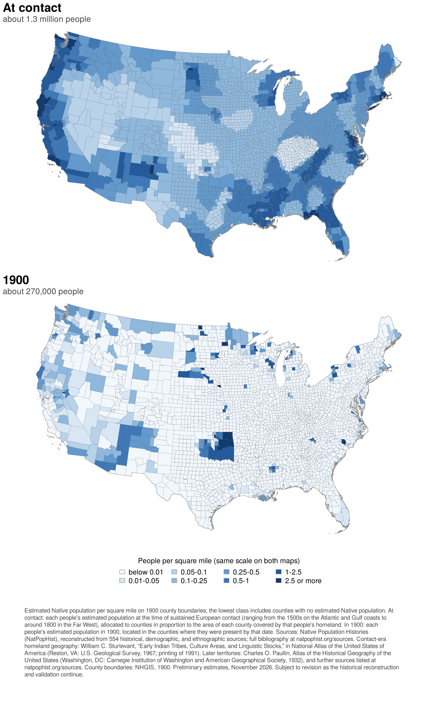

Native Population Histories (NatPopHist) is a research database of the population histories of Native peoples in what is now the contiguous United States, from European contact to 1900. It brings together population estimates, historical homeland maps, documented epidemic outbreaks and records of violent conflict, drawn from published historical, demographic and ethnographic research.

The reconstruction follows what colonial and ethnographic records captured, with their gaps and their outsiders' perspective. Names, territories and figures are documented to their sources, uncertainties are reported, and corrections are welcome. The database serves scholarly research; Native nations' own histories and accounts of their territories are the authoritative ones.

[Estimated Native Population from contact to 1900]{.natmap-heading}

::: {.column-screen .natmap}
```{=html}
<figure class="natmap-figure">
  <a class="natmap-wide" href="images/natpophist_contact_1900.png" title="Open the full-resolution map">
    
  </a>
  <a class="natmap-narrow" href="images/natpophist_contact_1900_stacked.png" title="Open the full-resolution map">
    
  </a>
  <p class="natmap-open"><a class="natmap-wide" href="images/natpophist_contact_1900.png">Open the full-resolution map</a><a class="natmap-narrow" href="images/natpophist_contact_1900_stacked.png">Open the full-resolution map</a></p>
</figure>
```
:::

The datasets and full documentation are in preparation; the first research release is planned for 2027.
